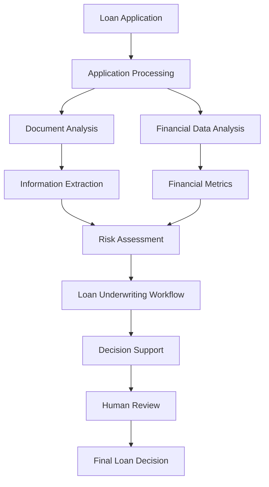
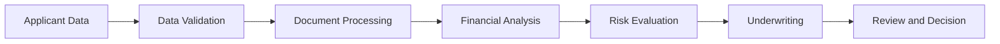

# 🏦 Agentic AI Loan Origination System

<p align="center">
  <b>An AI-assisted approach to loan processing, financial analysis and risk assessment.</b>
</p>

<p align="center">
  
  
  
  
  
</p>

---

## 📌 Overview

The **Agentic AI Loan Origination System** is a Python-based project exploring how AI and automation can support the loan origination and underwriting process.

It focuses on organizing loan-related workflows, analyzing financial information, extracting insights from documents and identifying potential financial risks.

The project brings together different modules for document intelligence, financial analytics, risk management and API-based application workflows.

## 🎯 Project Objectives

- Explore AI-assisted loan processing workflows.
- Analyze financial information and identify potential risks.
- Explore document classification and financial entity extraction.
- Organize loan underwriting tasks into modular components.
- Understand how AI-based systems can support human decision-making.

## ✨ Key Modules

| Module | File | Purpose |
|---|---|---|
| Main Application | `main.py` | FastAPI application and workflow entry point |
| Advanced Analytics | `advanced_analytics.py` | Portfolio metrics and analytics framework |
| Document AI | `advanced_document_ai.py` | Financial document analysis and classification |
| Financial Models | `advanced_financial_models.py` | Financial modelling components |
| Risk Management | `risk_management.py` | Risk monitoring and risk assessment framework |
| API Platform | `api_platform.py` | API-related functionality |
| Banking Integrations | `banking_integrations.py` | Banking integration components |
| Customer Experience | `customer_experience.py` | Customer-related workflow components |
| ETL | `etl.py` | Data processing and transformation |
| Configuration | `config.py` | Application configuration |

## 🧠 System Architecture

The following diagram represents the high-level workflow this project is designed to explore.



## 🔄 Loan Processing Workflow



## 🛠️ Technology Stack

### Programming and API
- Python
- FastAPI
- Pydantic
- Uvicorn

### AI and Machine Learning
- LangChain
- LangGraph
- LangFuse
- PyTorch
- Transformers
- Scikit-learn
- FinBERT

### Data Analysis
- Pandas
- NumPy
- SciPy
- Statsmodels

### Document Processing
- OpenCV
- Pillow
- NLP-based document analysis

### Other Tools
- Docker
- Redis
- PostgreSQL

*The dependency list is based on the project's requirements file. Individual integrations may require additional configuration.*

## 📊 Analytics and Risk Assessment

The project includes code modules exploring:

- Portfolio performance metrics
- Loan approval and default-related indicators
- Financial risk categories
- Risk thresholds and alerts
- Predictive analytics concepts
- Financial document insights

These are analytical capabilities in the codebase, not independently validated production performance results.

## 📁 Repository Structure

```text
Agentic-AI-Loan-Automation/
│
├── main.py
├── demo.py
├── demo_augmented_underwriter.py
├── demo_business_banking_underwriter.py
│
├── advanced_analytics.py
├── advanced_document_ai.py
├── advanced_financial_models.py
├── risk_management.py
│
├── api_platform.py
├── banking_integrations.py
├── customer_experience.py
├── enterprise_security.py
├── real_time_integrations.py
│
├── etl.py
├── config.py
├── integration_example.py
├── integration_summary.py
│
├── setup_augmented_underwriter.py
├── requirements.txt
├── docker-compose.yml
├── LICENSE
└── README.md
```

## ⚙️ Installation

### 1. Clone the repository

```bash
git clone https://github.com/gayu1719/Agentic-AI-Loan-Automation.git
```

### 2. Open the project folder

```bash
cd Agentic-AI-Loan-Automation
```

### 3. Create a virtual environment

```bash
python -m venv venv
```

### 4. Activate the environment

Windows:

```bash
venv\Scripts\activate
```

### 5. Install dependencies

```bash
pip install -r requirements.txt
```

### 6. Application setup

The main application imports additional modules from a `src` package. Restore or configure those required modules before starting the application.

Once the application dependencies and source modules are configured, the FastAPI application can be started with:

```bash
uvicorn main:app --reload
```

## 🚀 Future Improvements

- Complete and validate the end-to-end loan workflow.
- Improve document extraction and validation.
- Add test coverage for individual modules.
- Improve explainability of risk assessment.
- Connect and test external data integrations.
- Add a user-friendly application dashboard.
- Improve API documentation and error handling.

## ⚠️ Project Status

This repository is a development and learning project.

The modules and integrations should be tested individually before treating the complete system as a working loan processing application. No production accuracy, speed or financial performance benchmarks are claimed.

## 👩‍💻 Author

**Gayatri Shelke**

B.Tech – Artificial Intelligence & Data Science

GitHub: [@gayu1719](https://github.com/gayu1719)

---

<p align="center">
  <b>Exploring the possibilities of Agentic AI in financial technology.</b>
</p>
